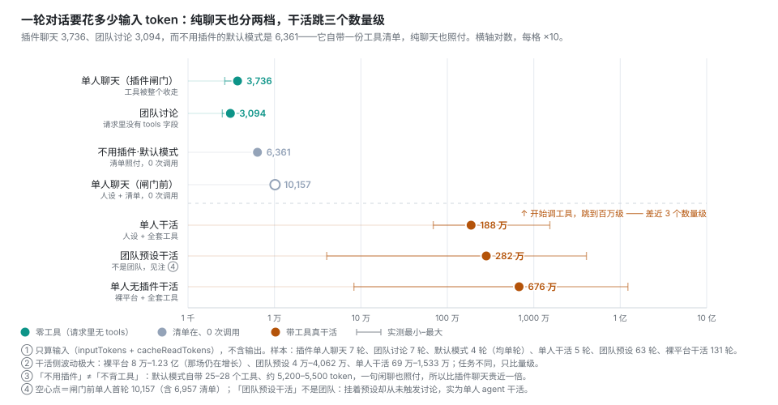
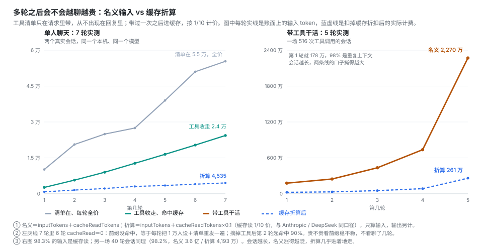

# dsh-waifu-agents


给 DSH 装上一批**用 Markdown 写的角色**：会话开到一半能换人，也能让一组角色在同一场对话里一起说话。

模式默认全局一种，单个会话可以另外单独设一种——所以在都要干活的环境里，你可以把某一场设成只陪聊。

角色文件放在你自己电脑上，卸载插件也不会删。

## 目录

- [三十秒上手](#三十秒上手)
- [五条命令](#五条命令)
- [人设文件](#人设文件)
- [面板](#面板)
- [聊天模式与工作模式](#聊天模式与工作模式)
- [团队会话](#团队会话)
- [记忆](#记忆)
- [省不省 token](#省不省-token)
- [什么时候生效](#什么时候生效)
- [常见问题](#常见问题)
- [更新插件](#更新插件)

## 三十秒上手

|   | 做什么                                                            |
| - | -------------------------------------------------------------- |
| 1 | 设置 → 插件 → 添加插件，输入 `dsh-waifu-agents`，装完在卡片上点「**启用**」（装和启用是两件事） |
| 2 | 开一个**新任务**，在还没发消息的那一屏点预设名 → 选她；聊到一半想换人，发 `/waifu-change 名字`    |
| 3 | 想让她成为**以后新会话**的默认：打开插件面板，打开她那一行右边的开关                           |

新任务页找不到预设选择器：设置 → 通用 → 打开「显示代码工作视图」。

## 五条命令

| 命令 / 用法                 | 作用                                                                                |
| ----------------------- | --------------------------------------------------------------------------------- |
| `/waifu-change 名字`      | 直接换成她；不打名字就弹选择器（名字打前几个字、能唯一对上就行）                                                  |
| `/waifu-current`        | 这一场现在谁在回答、是什么模式                                                                   |
| `/waifu-reset`          | 撤销这一场的换人 / 换队，回到**这个会话开始时选的那位**；团队会话用它退队。`/waifu-reset global` 搬去全局默认             |
| `/waifu-team 队名`        | 把这一场交给那个队；不打队名则看当前是单人还是某队                                                         |
| `/waifu-mode here chat` | 不带参数看模式；`chat` / `work` 改全局；`here chat` / `here work` 只改这一场；`here inherit` 改回跟随全局 |

换人、换队**从下一轮开始**，你正在打的这句不受影响；换模式当场生效。

## 人设文件

放在人设目录（默认 `~/.dsh/personas`）里的一个 `.md`：

```markdown
---
name: 显示名
description: 一句话简介
group: 组名
---

正文：这个人独有的那部分。
```

开头那几行都可以省。**多个角色共用的规则写进 `_common.md`**，正文位置用 `[[body]]`，改一次所有人一起变——在开头加一行 `template: _common.md` 就会套上骨架：

```markdown
现在起，你是「[[name]]」。

[[body]]
```

正文里**不要写 `{{…}}`**——平台只认 `{{provider}}`、`{{model}}`、`{{cwd}}`，写别的会话直接起不来。

插件所有东西都在这一个目录：你的 `.md`、`overrides.json`、`teams.json`、`team-memory/`、`persona-memory/`。放在自己的用户目录里，升级、卸载都不动它。

## 面板

设置 → tab **waifu-agents**，分四页：

| 分段     | 干什么                                              |
| ------ | ------------------------------------------------ |
| **人设** | 新增 / 编辑 / 改名 / 分组 / 排序 / 搜正文 / 批量隐藏 / 导入导出，都在这一页 |
| **团队** | 建队、设默认、剧情记忆设置                                    |
| **记忆** | 每个角色记得什么、开关、保存上限                                 |
| **设置** | 人设目录、公共骨架、分页、彻底清理、版本                             |

几条习惯：

- 编辑是**离开输入框自动保存**，没有保存按钮。
- 只有行首的 **▸** 会展开编辑器，点名字不会。
- 行尾的**眼睛**看组装后的成品（模型真正收到的那份）。
- 改名字时**文件名自动跟着变**；改名不会丢正文。
- 隐藏是改名成 `.md.off`，正文还在，随时取消隐藏。
- 会动数据的事都会先弹一次确认。

## 聊天模式与工作模式

模式决定这一场手里有没有工具，和人设、团队互不影响。

|      | 聊天模式                  | 工作模式        |
| ---- | --------------------- | ----------- |
| 能做什么 | 只说话，不碰文件、不跑命令         | 全套工具        |
| 每轮开销 | 3–4 千 token（工具清单不进请求） | 高得多，干多少活算多少 |

- `/waifu-mode chat`、`/waifu-mode work`：改全局，**当场生效**。
- `/waifu-mode here chat`、`here work`：**只改这一场**，别的会话不变；`here inherit` 把这一场改回跟随全局。
- 面板「设置 → 模式」里那两个 tab 就是全局开关。
- **想这一场只陪聊、别的照常干活**：全局保持「工作」，在这一场发 `here chat`。别用全局的 `/waifu-mode chat`——那是把默认换掉，没单独设过的会话会一起变成聊天。
- **团队永远不拿工具**，跟这一项无关。

反过来（全局聊天 + `here work`）只能拿回一部分工具，命令会当场说明，不会假装成功。所以混用只有一种做法：**全局工作，个别场次 `here chat`**。

## 团队会话

单人是一位角色回答你；团队是一组人设在同一场里接着聊，你就在她们中间。整场由**一次**生成完成。

|       | 单人                    | 团队                    |
| ----- | --------------------- | --------------------- |
| 谁在回答  | 一位                    | 一组，接话 / 反驳 / 附和       |
| 能不能干活 | 能（工作模式下）              | **不能**，每一轮都没有工具       |
| 怎么退出  | 再切一位，或 `/waifu-reset` | 切回一位，或 `/waifu-reset` |

用之前：

1. 面板 → **团队** → 新建团队：名字（必填）、背景（可选）、成员（**至少两个人**）。
2. `/waifu-team 队名` 把这一场交给它；下次想直接用它开场，就在新任务页选它（团队也占一个预设位）。
3. 之后如果成员的人设被删掉、隐藏或改名，解析出来不足两位，这一轮才按单人跑——面板和回复里都会点名少了谁。

聊天时的两件事要知道：

- 只聊剧情，写代码、跑命令请切回单人。
- 台词里若出现 `〔某个角色名〕` 会被当成新的一段——贴代码前把那对方括号去掉。

## 记忆

两套记忆，分开存、分开管：

|      | 剧情记忆     | 长期记忆              |
| ---- | -------- | ----------------- |
| 记什么  | 上下文都聊了什么 | 她经历过什么            |
| 跟着谁  | 会话（× 队伍） | 角色                |
| 换会话后 | 从零开始     | **还在**（换项目、重开都还在） |

- **剧情记忆**：团队每轮自动存，默认保留 7 天，可在团队编辑器里改；「强制清空记忆」立刻删光，慎点。
- **长期记忆**：单人回合正常结束后记一条，**不额外调用模型**。
- 每人默认存 **20 条**（可改 1–200），超了淘汰最旧的；每轮**最多注入 3 条**，只注入与这句话相关的，不相关就一条都不给。
- 新记的都是「情节」，只在那支队里可用；想让别的会话也为她用上，在面板上标「**稳定**」。
- **工作模式的回合默认不记**（干活时最长的那句往往是代码）；想记就在「记忆 → 工作模式也记」打开。
- 清空 ≠ 关闭 ≠ 停用：关闭是不读不写、内容留着；清空是删内容、开关不动。

## 省不省 token

同一场对话，给不给工具差三个数量级：

| 形态                |   一轮输入 |    50 轮累计 |
| ----------------- | -----: | --------: |
| 聊天模式 · 团队 2 人     |  2,484 |   124,200 |
| 聊天模式 · 团队 3 人     |  3,094 |   216,400 |
| 聊天模式 · 单人         |  3,736 | ≈ 400,000 |
| 没开聊天模式 · 单人（装了插件） | 10,157 | 1,869,100 |
| 没开聊天模式 · 单人（不装插件） |  6,361 | 1,771,150 |





聊天模式的请求里真的没有工具清单，一轮全在 3 千出头。不装插件是 6,361——其中 5 千多是宿主自带的 25–28 个工具，一句闲聊也照付；装了插件却没切聊天模式是 10,157，多出来的还是那张清单。累计形状也不同：单人和裸平台每轮重发全部历史，越聊越陡（二次增长）；团队每轮只发「队伍背景 + 成员人设 + 这一句」，是一条直线，开记忆后先缓涨、封顶走平。而工具清单带过一次就进缓存，之后按 1/10 计价——开了聊天模式后 7 轮里 90.4% 是缓存读，名义 2.4 万折算下来 4,535；不开则 7 轮有 6 轮没命中，名义 5.5 万、折算 5.1 万，几乎没打折。真开工（工作模式调工具）整场 188 万起，裸平台约 680 万。

**所以：省 token 靠「这一轮要不要工具」，不靠删人设、也不靠剪骨架。**（名义＝`inputTokens + cacheReadTokens`，折算再加缓存读 × 0.1；只算输入，看量级不是报价。）

## 什么时候生效

| 改了什么           | 什么时候管用                    |
| -------------- | ------------------------- |
| 切换人设 / 团队 / 模式 | 下一轮（模式是当场）                |
| 人设正文、公共骨架      | 已经开着的会话下一轮就用新的            |
| 名字、简介、分组、顺序    | 面板里保存立刻生效；面板外改的，点一次「刷新」   |
| 升级插件           | 以面板那句话为准：可能当场生效，可能要重启 DSH |

## 常见问题

**面板里一个人设都没有？** 先点「刷新」；再确认文件在「设置 → 目录来源」那个目录、后缀是 `.md`、不是 `.off`。

**某一行提示「激活失败」「ID 占用冲突」？** 多半是热重载时新旧实例并存，**完全退出 DSH 再启动**，提示消失就没事。

**保存被拒，说「磁盘上变过」？** 这行在别处被改过了，重新打开载入最新内容再改一次（被拒时磁盘上什么都没写）。

**拖不动行？** 「拖拽排序」每次打开面板都是关的，在工具条里打开；开着时行内按钮会一起锁住。

**只有一个人说话，是不是坏了？** 不是。谁接谁由内容决定，不必人人开口。真会退回单人的只有一种情况：队伍里的人设被删掉、被隐藏之后，解析出来剩不到两位（建队时至少要两位，所以这只会发生在建好之后）。

**`/waifu-reset` 回的是全局默认吗？** 不是，是这个会话开始时选的那位。想搬去当前全局默认就写 `/waifu-reset global`。

**这些命令花 token 吗？** 不花。它们只改本地状态，不调用模型。

**卸载会删人设吗？** 不会。卸载前到「设置」点「彻底清理」，会清掉覆盖和默认指向；勾上「连人设目录一起删」才会动你的文件。

## 更新插件

面板顶部或「设置 → 版本行」出现新版本时点它：确认窗里勾一下，它自己下载安装，装完告诉你「已经生效」还是「要重启 DSH」。

升级会换掉**插件自己带的东西**：

- 代码（整包替换）
- 人设目录里的骨架 `_common.md` 和说明 `README.md`——这两个是插件资产，跟着版本走。包里的话术改进了，你这里会同步换掉；换之前那份存成 `_common.md.bak-<时间戳>` 留在旁边，想找回随时能找。

升级**不碰**你的数据：人设 `*.md`（包括你自己的和大肥鱼）、`persona-memory/`、`teams.json`、`overrides.json`、`mode.json`。

只有插件自己建出来的那个目录（默认 `~/.dsh/personas`）会这样更新。你手动指到别处的目录（比如桌面上放角色的那个文件夹）插件一个字节都不往里写。

从命令行装的时候**写精确版本号**（`dsh-waifu-agents@版本号`，用 npm 页面上最新那个）。刚发布的版本用裸包名可能被 pnpm 的新版本冷静期挡住。
