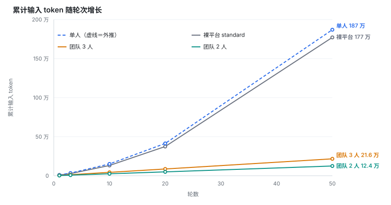

# dsh-waifu-agents


**Waifu Agents** 是一款面向 **DSH** 的「人设 + 多角色同场」插件：既能把 **Markdown 人设**注册成 Agent Preset、在会话中途 **动态切换** 单个角色，也能把**一组人设**放进同一场对话里同场开口（团队模式）。两种形态共用同一份人设文件：**单人**是一位角色回答你，**团队**是一组角色在同一个场景里互相接话——**都由同一个模型一次写完全场**，不是多个 Agent 分工协作（写得特别长时会自动续写，但那仍是同一场、同一个模型接着写，不是分工）。公共提示词、分组排序、搜索、隐藏、默认人设、面板内自升级一应俱全，让你灵活地定制和管理 AI 的角色、性格与回复风格。

## 它能做什么

| 能力                     | 一句话                                                                                                  |
| ------------------------ | ------------------------------------------------------------------------------------------------------- |
| **轮次级换人**           | 会话开到一半，`/waifu-change 名字` 就**从下一轮**开始由她回答——不用新开会话，不用重启                   |
| **两层人设，互不干扰**   | **会话级**：这一个会话用谁；**全局默认**：以后新建的会话用谁                                            |
| **面板就是全部**         | 新建 / 编辑 / 改名 / 分组 / 排序 / 搜正文 / 批量隐藏 / 导入导出，一个标签页里做完                       |
| **公共条款只写一次**     | 共用框架放进 `_common.md`，每篇只写她自己那段；改一次，所有人一起变                                     |
| **顺序永远对**           | 自定义人设一定排在四个内置模式（standard / ptc / minimal / cordis）**下面**，团队预设再排在**所有人设**后面；各自内部顺序可拖拽 |
| **面板内自升级**         | 面板里检查版本 → 确认 → **进度窗**告诉你 pnpm 在干什么 → 装完明确说「重启 DSH 生效」                    |
| **改完当场生效**         | 换默认立刻反映到新任务页，连屏幕上那个还没开口的空会话也一起换                                          |
| **多人同场（团队模式）** | `/waifu-team <队名>` 把这场会话交给一组人设，**一次生成、全员轮流开口**——她们接话、反驳、赞同，你就在场。**不接工具、不记历史**，定位是同场演出而非执行任务（见第六节） |

## 四条常用命令

会话已经开着、想换人 / 换队的时候用：

| 命令             | 作用                                                                                                                    |
| ---------------- | ----------------------------------------------------------------------------------------------------------------------- |
| `/waifu-change`  | **不带参数**：弹出选择器（可搜索、按分组、当前那位打勾）。**带名字**：`/waifu-change 大肥鱼` 直接切；名字可以只打前几个字，前提是对得上唯一一位 |
| `/waifu-current` | 一句话告诉你这个会话现在是谁在回答                                                                                      |
| `/waifu-reset`   | 清掉本会话的人设/团队覆盖，回到「换人/换队之前这场会话在跑的那支/那位」（不是最后切到的，也不一定是全局默认）；**团队会话用它退出当前队** |
| `/waifu-team`    | **不带参数**：看当前是单人还是某队、列出可选队伍。**带队名**：`/waifu-team <队名>` 把这场会话交给那个队，全员同场开口   |

> **「轮次级」是什么意思**：换人 / 换队**从下一轮开始生效**，你正在打的那一句不动，已经发出去的回答也不会重写。下一轮请求会带上新人设（或新队伍），并附一句运行时身份确认，让模型彻底放下上一位

另有一个 `/persona <json>`：面板背后的内部接口（列目录、增删改、导入导出都走它），日常不用碰——面板上每个按钮最终都落到它上面，字段随版本在变，不要拿它写外部脚本。

## 三分钟上手

|     | 做什么                                                                                      |
| --- | ------------------------------------------------------------------------------------------- |
| 1   | **装并启用**：设置 → 插件 → 添加插件 → 输入 `dsh-waifu-agents` → 在卡片上点「**立即启用**」 |
| 2   | **开聊**：开一个**新任务**，在还没发消息的那一屏点 preset 名字 → 选她                       |
| 3   | **让她当新会话的默认**：打开插件面板，动她那一行右边的开关                                  |

## 目录

- [一、安装与启用](#一安装与启用)
- [二、人设从哪来：目录、文件与公共骨架](#二人设从哪来目录文件与公共骨架)
- [三、面板：人设、团队与设置](#三面板人设团队与设置)
- [四、日常操作](#四日常操作)
- [五、换人与换队](#五换人与换队)
- [六、多人同场：团队会话（Team Mode）](#六多人同场团队会话team-mode)
- [七、什么时候生效](#七什么时候生效)
- [八、更新插件](#八更新插件)
- [九、常见问题](#九常见问题)

---

## 一、安装与启用

设置 → 插件 → **添加插件**，输入包名：

```
dsh-waifu-agents
```

想锁定版本就写精确版本号（升级时**必须**这么写，见第八节）：

```
dsh-waifu-agents@0.1.4
```

装完**要在卡片上点「启用」**，否则一个人设都不会出现——**安装和启用是两件事**。

## 二、人设从哪来：目录、文件与公共骨架

### 人设文件

```markdown
---
name: 显示名
order: 20
description: 一句话简介
group: 组名
template: _common.md
---

正文：这个人**独有**的那部分。
```

- 开头这几行**都可以省**；第一个 `---` 之后的一切都是正文。
- **保留名**：`README.md`、`_template.json`、`_common.md`——扫描时跳过，也占不到这些 id。
- **`template: _common.md`**：正文插进骨架里 `[[body]]` 的位置，骨架里的 `[[name]]` 换成显示名。**不写这行就整篇注入**（老文件原样可用）。
- `group:` 只影响面板视图，不影响注册。`order` 决定顺序。
- **`order` 是插件内部的局部序号，注册时会整体加上 10000**：平台把四个内置模式（standard 1 / ptc 2 / minimal 3 / cordis 4）和人设放在**同一个**排序键上，直接把你写的 1、2、3 交出去就会和内置互相穿插。加偏移之后，无论你写多小，自定义人设一定排在内置四个**下面**。文件里存的一直是你自己那个号，拖拽排序也只改这一行。
- 通过面板保存 / 导入会**规范化文件**：只保留 `name`、`order`、`description`、`group`、`template` 五行（空的不写），正文去掉首尾空白，换行统一 LF。想留别的东西请放进正文。

### 公共骨架（`_common.md`）

放在同一个人设目录里：

```markdown
现在起，你是「[[name]]」。

[[body]]

【硬性边界】

- 表演层可以自由发挥；代码、路径、行号、命令参数必须一字不差。
```

- 必须**恰好一个** `[[body]]`；没有或有两个，保存都会被拒。
- `[[name]]` 可以出现任意次。
- 骨架里同样不许出现非法的 `{{…}}`。
- **改骨架会连已经开着的人设会话一起变**（下一轮生效，见第七节）。

### 人设放在哪

- **自动挑选**，顺序是：面板里指定的目录 → `<DSH 主目录>/personas` → 插件自带的出厂目录。中间这个主目录由 `DSH_PROFILE_DIR` 推出（取上两级），否则用 `DSH_HOME`，都没有就是 `C:\Users\你\.dsh`；这个 `personas` 不存在时，插件会**用出厂人设把它建出来**，实在建不出来（比如只读）才退回包内那份。
- 看当前用的是哪个：设置里的「**目录来源**」那一行。
- 换地方：路径填进「人设目录」→ 保存，插件会自己重启一次。
- **目录在插件包内时是只读的**：插件升级会整包替换它，写进去的人设会跟着没。看到这个提示就把目录换到包外。
- 目录在**你自己的用户目录**里，所以卸载插件**不会删掉任何人设**；重装后原样回来。
- **插件写在磁盘上的东西都在这个目录里**：你的 `.md`、一份 `overrides.json`（会话覆盖：哪个会话指定了谁、换人前是谁）、一份 `teams.json`（团队定义）、一份 `runs.jsonl`（团队运行账本，一行一次运行）。唯一的例外是目录只读时——`overrides.json` 会退到 `<DSH 主目录>/dsh-waifu-agents.overrides.json`。

## 三、面板：人设、团队与设置

面板 = 设置 → tab **waifu-agents**，里面分**三个分段**：

- **人设**：名册（新建 / 编辑 / 隐藏 / 排序 / 搜索……）
- **团队**：建队与编辑，以及「**让这支队成为新会话的默认**」（见第六节）
- **设置**：运维（目录、默认、清理、版本）

> 顺序是人设 · 团队 · 设置——团队和名册紧挨着，因为一支队伍本来就是从名册里挑人组成的。

**工具条**

| 按钮         | 作用                                                                                                                |
| ------------ | ------------------------------------------------------------------------------------------------------------------- |
| 搜索框       | 按名字 / 简述 / 分组 / id 筛选；打 **2 个字以上**还会搜正文，命中单列在「正文命中」里，标明来自**骨架**还是**正文** |
| 新增         | 在列表最上面开一张空卡片                                                                                            |
| 导入 md      | 选一个 `.md` 存进目录（同名会报错，不覆盖）                                                                         |
| 导出全部     | **只问一次、只存一处**：所有可见人设打进一个 `waifu-personas-YYYYMMDD.zip`（一次保存对话框，选一个文件夹），解压就是一堆 `.md` |
| 下载出厂人设 | 下载包内那份出厂人设，照着改，再用「导入 md」导回来                                                                 |
| 批量         | 勾选模式：全选 / 隐藏选中 / 导出选中 / 取消选择。「隐藏选中」也走**确认窗**，勾选后才执行                            |
| 拖拽排序     | **每次打开面板都是关的**——这个开关**不记忆**（以前存在浏览器本地，开过一次就永远开着，看起来像默认开启）。打开后整行都能拖，行内的展开、开关、导出、隐藏会锁住防误触 |
| 刷新         | 重扫并重新注册。手动放进目录的新文件、在面板外改过的名字 / 简介 / 分组 / 顺序，都要按一次（正文和骨架不用，见第七节）   |

**每一行**

| 控件     | 作用                                                                                 |
| -------- | ------------------------------------------------------------------------------------ |
| ↕        | 拖拽手柄。在工具条打开「**拖拽排序**」后出现；**整行都能拖**，拖到另一行上即保存顺序 |
| ▸ / ▾    | 展开 / 收起她的编辑器。**只有这个按钮会展开**，点名字不会——免得误触                  |
| 开关     | 她是不是**新会话的默认**。和 设置 → Agent Presets、**团队页那排开关**是**同一个值**：打开一个，其余全部自动取消（平台只有一格） |
| 下载图标 | 导出这一条 `.md`                                                                     |
| 隐藏图标 | 点一下**弹确认窗**，勾选后才能确认：文件归档成 `<id>.md.off`，**正文不删**           |
| 勾选框   | 只在「批量」模式下出现                                                               |

**设置页**（左边描述、右边操作）

| 行             | 作用                                                                                                                               |
| -------------- | ---------------------------------------------------------------------------------------------------------------------------------- |
| 人设目录       | 填路径 → 保存：插件会重启一次并重扫。灰着 = 路径没改                                                                               |
| 目录来源       | 目录是从哪挑出来的                                                                                                                 |
| 公共骨架       | 有没有骨架、文件在哪；按钮**就地展开编辑器**                                                                                       |
| 已隐藏         | 展开后逐条「取消隐藏」（**单个也会先弹确认窗**）；「全部取消隐藏」同样先弹确认窗                              |
| 新会话默认用谁 | 当前默认是谁 + 「关掉（谁都不指定）」；**也可能是一支队**，那时这一行显示「团队：名字」（团队页的开关写的是同一格）；默认指不到人时在这一行下面直接报错 |
| 分页           | 每页 N 条，默认关闭、打开时默认 **10**。**同一个分组不会被拆到两页**；**打开分页会直接落到默认人设所在的那一页**（不是第 1 页）；关掉再打开会记住你上次填的数。存在浏览器本地 |
| 彻底清理       | 清掉会话覆盖记录和全局默认指向；打开右边「连人设目录一起删」，才会动目录里的东西（`.md`、`teams.json`、`runs.jsonl` 一起没）。弹窗勾选后才执行 |
| 插件版本       | 当前版本 + 更新按钮。确认后原地换成**进度窗**，装完要你自己点「关闭」（见第八节）                                                  |

## 四、日常操作

- **新建**：点「新增」→ 填「名字」和正文（简述、分组可留空）→ **离开输入框自动保存**。什么都没填就点到别处，空卡片会被丢掉。目录里有骨架时，新建会**自动套上**它。
- **编辑**：点任意一行展开 → 改完**离开输入框自动保存**（切到别的行、离开标签页，最后一次改动都不会丢）。编辑框只有一种状态——就是编辑。
- **预览**：行尾的**眼睛图标**（和导出、隐藏并排）→ 弹窗里看她**组装之后的成品**：骨架 + 正文，也就是模型真正收到的那份。它读磁盘，而点它会先触发那次自动保存并等它写完——刚敲的字一定在里面。
- **改名**：直接改「名字」，**文件名自动跟着变**（转小写、空格标点折成 `-`，中文原样保留；撞名加 `-2`）。
- **导出**：单条用行尾的**下载图标**（一个 `.md`，一次保存）。**批量**（工具条的「导出全部」、批量模式的「导出选中」）走**一个压缩包**：只弹一次保存框、选一个位置，打开就是 `阿库娅.md`、`惠惠.md`……；不会像以前那样弹 N 次、还可能散到 N 个文件夹里。
- **隐藏 / 取消隐藏（不是删除）**：隐藏图标 → 弹窗确认 → 文件变成 `<id>.md.off`，提示是**「已隐藏 名字」**（不会把 `名字.md.off` 这种文件名甩给你）；批量隐藏提示是「已批量隐藏 甲，乙」。**取消隐藏**在「设置 → 已隐藏」里点一下（单个也先弹确认窗，确认后提示「已恢复 名字」；「全部取消隐藏」提示「已恢复 3/3」）；重复隐藏产生的 `.md.off.2`、`.3` 也在那儿。
- **会改数据的事都先问一句**：单条隐藏、批量隐藏、单条取消隐藏、全部取消隐藏、删除团队、彻底清理、安装新版本，一律是**同一个确认窗**（说清后果 + 一个勾选框，勾上才能点确认）。以前批量隐藏、取消隐藏和删除团队是点一下就执行，一次误点能把整批人设归档。
- **提示都是 DSH 自己的 toast**：保存成功、保存被拒、导入失败、团队校验没过——一律走平台顶部那条一次性提示（成功是打勾、失败是警告图标），**不会在列表里插一行绿字**。绿字有两个毛病：它跟着列表滚走，而且它只画在「人设」那一页里——在团队编辑器里存失败时它根本没地方显示，看起来就像按钮坏了。
- **调整顺序**：在「**人设**」工具条点「**拖拽排序**」（默认关着，防误操作）→ 整行可拖，拖到另一行上即保存——写进文件的 `order:`，重启后还在。开着的时候行内的按钮和展开会锁住，关掉立刻恢复。批量模式下始终不能拖。
- **分组**：在编辑器里填「分组」，名册就按组折叠。
- **搜索**：名字 / 简述 / 分组 / id 是本地筛选；正文搜索走 Host，只回片段。
- **正文里不要写 `{{…}}`**：平台的提示词渲染**只认 `{{provider}}`、`{{model}}`、`{{cwd}}`**，写别的会让整份系统提示词渲染失败、**会话直接起不来**。面板保存前会拦，Host 还会再拦一次。要写占位符请用 `[[name]]` / `[[body]]`。

## 五、换人与换队

- **从下一轮开始**，当前这句不动。
- 换人时，插件会在人设**前后各加一行**提示——开头「人设已切换」（点名作废之前的身份）、结尾「本轮身份 · 最后确认」——帮模型彻底放下上一位。
- 除此之外，换过人之后你每次提问后面还会多出一句「本轮身份 · 运行时确认」——插件替模型再确认一次「现在是谁」，只在身份真的变了的时候出现。看到它不用处理。

几个细节：

- **切回已经在用的那位，不会假装切换**：如果你 `/waifu-change` 到的正好是当前这位，它会回「本来就是 X · 没有改动」，而不是报「已切换」——因为人设内容没变，硬说切换是骗你的。
- **只列能用的人设**：你选中的那篇如果组装不出来，**不会替换**，这一轮仍然用原来那位。
- **`/waifu-reset` 也算换人**：回落之后这一轮照样会收到「人设已切换」和那句运行时身份确认，所以模型不会继续用刚被 reset 掉的那位说话。
- **`/waifu-reset` 回的是「这场会话换人/换队之前在跑的那支/那位」**（换人前的身份记在 `overrides.json` 的 `resting` 里），不是你最后切到的，也不一定是全局默认。它同时把 `/waifu-team` 的团队绑定一起清掉——团队绑定也算一层覆盖。如果这场会话从没换过，reset 会说「本来就没有覆盖，什么都没改」。
- **会话顶上那个标签会跟着变**：插件用平台自己的那条通道把标签挪过去，只动标签、不动正在跑的插件树——所以标签说的和模型听到的终于一致了。
- **一个副作用要知道**：标签也是**会话恢复时**用来决定挂载谁的。换过人之后，下次打开 DSH 恢复这个会话，它会真的按新人设装配（工具集也跟着换）——这正是「这个会话就是她」该有的样子，别惊讶。
- **顺序和分组**：名册按每篇文件的 `order:` 排，组内也是。填了「分组」就按组折叠显示；没填的归到「未分组」。**默认人设所在的那一组会自动展开并滚到她**。组名**只在组头上出现一次**，行里不再重复一个分组小标签——同一行上下各写一遍，看起来像两个互不相干的属性。

## 六、多人同场：团队会话（Team Mode）

> 单人模式是一个「人设」回答你。**团队模式**是**一组人设**在同一场对话里轮流开口：她们接话、反驳、赞同、吐槽，你就在她们中间。整场讨论由**一次**模型调用生成，再按角色逐段流式呈现——所以你看到的是她们一段一段地聊，而不是等半天再一次性甩出来。

### 它和普通换人有什么不同

|          | 单人换人（`/waifu-change`）                 | 团队会话（`/waifu-team`）                            |
| -------- | ------------------------------------------- | ---------------------------------------------------- |
| 谁在回答 | 一位人设                                    | 一组人设**同场**                                     |
| 一次生成 | 一段回答                                    | 全场多段对话                                         |
| 你看到的 | 她一个人说                                  | 她们接龙式地聊，你在场                               |
| 退出方式 | `/waifu-change` 再切一位，或 `/waifu-reset` 回到换人之前 | `/waifu-change` 切回单人，或 `/waifu-reset` 回到换队之前 |

### 它不做什么（先看这条，能省一次失望）

团队模式是**剧场**，不是**工位**。两条是硬边界，不是暂时没做：

| 不做什么         | 为什么                                                                                                                       | 你该怎么做                                     |
| ---------------- | ---------------------------------------------------------------------------------------------------------------------------- | ---------------------------------------------- |
| **不调用任何工具** | 团队请求是「队伍背景 + 成员人设 + 这一句」，**不带工具清单**（`tools` 和 `toolHistory` 都没有）。她们读不到你的文件、跑不了命令、搜不了网页 | 要动手就切回单人：`/waifu-change 名字`         |
| **不记得上一轮**   | 每轮只带「系统提示 + 本次输入」，**不带历史**。第二幕的她们不知道第一幕发生了什么                                     | 连续剧情自己补一句前情，或者改用单人           |

这两条是同一个架构决定的：**整场讨论由一次模型调用生成**，输出必须是 `〔名字〕台词` 这样的分段文本。工具调用返回的是结构化的调用请求、不是文本，而且一次调用只能返回一组、没法归给某一个角色——硬塞进来会把分段协议打散。所以不是「忘了接」，是接了就不能这样演。

代价与好处一起说清：正因为不吃那套工具清单（在单人模式里它占首轮输入的 **82%**），团队是三种形态里最便宜的——每轮**输入**约 2,484 token（2 人）／4,328（3 人），随人设长度浮动，而且**不随轮次增长**（单人/裸平台每轮要重发全部历史）。

一句话：**想让她们聊，用团队；想让 AI 干活，用单人。**

### 怎么定义一支队伍（在面板里做）

打开 设置 → waifu-agents → **团队** 分段，点「**新建团队**」，填这几项：

| 项           | 说明                                                                                              |
| ------------ | ------------------------------------------------------------------------------------------------- |
| **名字**     | **必填**。队伍名，也是 `/waifu-team <这个名字>` 要打的字。没填就点保存，会直接在名字框下面标红提示，不会存 |
| **背景**     | **可选**，一句话设定（她们彼此的关系、已知的事）。每次讨论都带着；成员看不到主对话，只信这一栏   |
| **成员**     | **必填**。用「**加人设**」挑单个角色，或用「**加组**」把某个分组里所有人一次拉进来；人设和组可混用 |

点「**保存**」即生效。两项必填任意一项没填，都不会写文件，也不会关掉编辑器——提示就在那一条旁边，不在屏幕顶上飘一下就走。

> **改名是改名**：点既有队伍的「**编辑**」，把名字改掉再保存，改的是**这一支队**（成员、背景都留着），不会多出一支同名的队。已经绑在这支队上的会话会跟着新名字走，不用重新 `/waifu-team`。

> **人数上限**不在单支队伍里，而是「团队」分段底部的两行全局设置，对所有队伍生效：**人数上限**（留空 = 不设限，设了必须是不小于 2 的整数）和**超限怎么办**（「超出就不跑」= 这一轮整队不跑；「超出取前几个」= 只留名单里靠前的几个，其余跳过并点名）。

> 队伍数据背后存成 `teams.json`（和人设目录里的 `overrides.json` 同目录）、所有会话共用；但你日常只跟面板打交道，**不用手改 JSON**。每个团队同时也是一个预设，会出现在新建会话时的模式列表里，排在**所有人设后面**——选了它，这个会话一出生就在团队模式。

> **让一支队成为新会话的默认**：团队列表里每行右边有一个开关，和她那一行上的是**同一个开关**——平台的 `selectedDefault` 只有一格，所以**打开团队的默认，人设那边就自动取消选中**，反过来也一样。打开之后，新建的会话一出生就在这支队的团队模式里。团队还没注册成预设（刚建好、同步还没跑完）时开关是灰的，旁边会写原因；改名或删掉这支已设默认的队，那个指向会跟着改名走 / 被清掉，不会留下一个指不到任何东西的默认（那会让**每个新会话都开不起来**）。

- 成员引用的人设**必须还在名册里、能正常解析**；失效的成员在编辑器里标「**已失效**」并仍占名额，需要去掉或改回目录里有的名字。
- 一支队**至少解析出 2 名成员**才会以多人模式开口；凑不够就按单人模式跑——面板里标「只解析到一个人，按单人模式跑」，命令会直接说清是哪支队、只剩几名成员。
- 面板只负责**建队**；把某支队**绑定到当前会话**（上线）要用 `/waifu-team <队名>`。
- 删队（列表里那一行）会先弹**确认窗**：删掉的是 `teams.json` 里的这条定义，成员人设文件原封不动；已经绑在这支队上的会话退回单人模式。

### 怎么进场

| 方式 | 怎么做                                                            |
| ---- | ----------------------------------------------------------------- |
| 命令 | `/waifu-team <队名>` 直接选队；不带参数先看当前是谁、有哪些队可选 |
| 面板 | 只负责**建队 / 改名 / 删队**，**不能**把队伍绑到某个会话——上线、下线都是会话级操作，用 `/waifu-team` |

选完**从下一轮开始**生效——你正在打这句不动，下一句起她们就同场了。会话顶上那个标签（chip）也会跟着换成这支队伍；`/waifu-reset` 会把它换回这场会话原本的那支/那位。

> 标签也是**重启后还认不认这支队**的依据：插件把绑定挪到标签上，下次打开 DSH 恢复这个会话，它还是这支队伍。

### 怎么退出团队

用这两条之一：

- `/waifu-change 大肥鱼` —— 切到某一位人设；
- `/waifu-reset` —— 回到这场会话原本的那支/那位（不是当前绑定的这支，见下方常见问题）。

### 卡顿、超时与「被截断」（团队模式的可靠性）

团队模式一次生成的提示很长、分段多，最怕上游网络慢或中途断流。这部分做了几件事，你体感上应该能注意到：

- **单次请求有约 2 分钟墙钟上限**：某一次模型调用如果卡住不动，插件不会无限等——到时自动中断，然后退避重试（最多重试 2 次，也就是同一轮最多 3 次尝试）。
- **黑屏卡死会自动重试**：一个字都没吐出来就超时，会干净地重试，通常不耽误你什么。
- **流了一半卡死，先补完再保留**：如果断在半句（断点落在没闭合的引号/括号里），插件会按「没写完」自动续写（带上已说内容，最多续 2 次），能补完就补完、末尾正常收口；只有续写次数用完还断着，才**保留**已说部分并提示「这一轮因为连接卡住被截断了，已保留说出的部分」——而不是把整段对话一起扔掉。
- **上游主动报超时 / 断连也重试**：`TIMEOUT` / `TRANSPORT` 这类错误在「没产出内容」时同样会退避重试。
- **长度不再事先定死**：一次请求最多写约 4,000 token，但这是技术兜底，不是「这一轮只能这么长」。写到头还没说完，会自动接着要下一段（最多续 2 次），并把已经说过的内容一并带上，让她们从下一位接着讲——所以长讨论不会被掐断，短寒暄也照旧很快收住（什么时候停由内容决定，不由预算决定）。
- **写到很长会自己收口**：快到上限时，最后一位接话的人负责把结论、还没谈拢的分歧、下一步说清，然后结束——不再开新话题。所以长讨论的结尾是「收住了」，不是「断了」。寒暄这种一层就问完的不会硬加总结。
- **有人没开口会补一次**：如果一轮正常结束了、但还有成员一句话没说，会再请求一次，只请这几位开口。**这一步排在收口前面**——不会为了让最后一个人总结就把没说过话的人跳过。补了一次仍不说，才在末尾点名告诉你「某某没开口」。

> 如果你发现某场对话**整段消失**，或者**连着好几分钟一个字都没有**，多半是上游当时真不稳（一次尝试最长约 2 分钟，3 次都空手才会放弃）；重试仍失败会在末尾明确告知原因，而不是假装成功。

## 七、什么时候生效

**下一轮生效，已经发出去的那句不生效。**

- **改正文**：已经开着的会话**下一轮**就用新的——提示词每轮都按磁盘上那份文件现拼（面板保存会清掉缓存，外部编辑器改的按修改时间也认得出来）。不用新开会话，也不用重启。
- **改骨架**：所有套用它的人设会话，下一轮一起变（每轮都按当前骨架重新组装），不只是新会话。骨架编辑器里也写着这句。
- **命令**（`/waifu-change` 等）**从下一轮开始生效**。
- **名字 / 简介 / 分组 / 顺序 / 新增的文件**：这几项在**注册**时定下来。面板里改完保存会立刻重新注册；**手动放进目录**的、或者你在面板外改的，要按一次「刷新」。
- **升级插件**要重启 DSH；**换目录**会让插件自己重启一次。

**所以要按「刷新」的是这几件事**：手动放进目录的新 `.md`、以及在面板外改过的名字 / 简介 / 分组 / 顺序。面板里保存的不算——它当场就重新注册了；正文和骨架也不算——它们每轮现拼。

**用外部编辑器改过同一个文件？** 面板保存时会带上「我读到的那一版」的指纹；对不上就**拒绝写入**，而不是覆盖对方。重开这一行载入最新内容再合并。每次覆盖前旧内容留一份 `<id>.md.bak`，写入走「临时文件 + rename」，不会有半截文件。

## 八、更新插件

- 面板**顶部**有新版时会多一条「有新版本 X（当前 Y）」+「查看」；
- 「**设置**」里的**版本行**也有一个按钮。

两条都打开**同一个确认窗**：

1. 窗里写着当前版本、要装到哪个版本、这次会做什么；
2. **勾选**「我知道这会安装新版本，并且需要重启 DSH」才能按确认——确认键在勾选前是灰的；
3. 确认后**窗口不会关**，原地换成**进度窗**（见下）；
4. 装完**必须重启 DSH**。

没有新版时，那个按钮是「**已是最新版本**」——它是状态，点一下等于重新检查。

### 进度窗

点确认之后那个窗**一直开着**，直到你自己点「关闭」。它显示：

- **进度条**：跟着平台报的阶段走（准备 → 从源安装 → 应用配置）。阶段之间的百分比是**估算**的：平台报的是阶段，不是字节数，没有真值可显示。条子只在**真的装完**那一刻才满。
- **一行状态**：此刻在做什么。
- **下载源计数**：这个 profile 配了多个源时，会写明「第 1/2 个源」——换源重试表现为条子**前进**，而不是倒退。
- **已用时间**：秒数一直走，所以你分得清「慢」和「卡死」。万一平台的进度回报迟迟不来，这里也会直说，而不是假装一切正常（安装本身仍在进行）。
- **pnpm 输出**：可展开，就是 pnpm 自己打的那几行。
- **结果**：成功会说「已装到磁盘，重启 DSH 后生效」；失败会把原因和 pnpm 的原话摆出来，并给一个「**重试**」。

**把进度窗关早了也不要紧**：面板顶部会留一条状态（正在更新 / 已更新到 vX / 上次更新失败），点「查看」就能把它叫回来。

> 为什么要写**精确版本号**：刚发布的版本用裸包名可能被 pnpm 的「新版本冷静期」挡住（`ERR_PNPM_MINIMUM_RELEASE_AGE_VIOLATION`），精确版本号会被自动放行。面板里这个更新按钮走的就是精确版本号。

## 九、常见问题

**新任务页上找不到 preset 选择器。**
设置 → 通用 → 打开「**显示代码工作视图**」。

**面板里一个人设都没有。**
先按「刷新」；再确认文件确实在「设置 → 目录来源」显示的那个目录里、后缀是 `.md`、结尾不是 `.off`。

**某一行带「未注册」或「激活失败」。**
两边说的不是一回事：「未注册 · 这个 id 被别的所有者占用了」= 这一行确实看到别处已经注册了同名的 preset，改个名字再刷新；「未注册 · 没注册上，点刷新重试」= 注册这一步没落地（改了正文、刚保存完都在这一档），按一次「刷新」就会重新注册。「激活失败：…」冒号后面就是原因。

**保存被拒，提示「磁盘上变过」。**
文件在你打开这一行之后被别的程序改过。重开这一行载入最新内容，合并后再保存。旧内容还在 `<id>.md.bak`。

**正文里写 `{{char}}` 为什么不让保存？**
平台的提示词渲染只认 `provider`、`model`、`cwd`，写别的会让整份系统提示词渲染失败——**会话根本起不来**那个级别。面板会拦，Host 还会再拦一次。占位符请用 `[[name]]` / `[[body]]`。

**什么是「公共骨架」？**
一份 `_common.md`，装所有人设共用的条款。写了 `template: _common.md` 的人设只写自己那段，注册时自动拼起来——改一次公共条款，所有人一起变。

**拖不动行，或者一拖就点到按钮了。**
「拖拽排序」**每次打开面板都是关的**（防误操作，而且这个开关不记忆），在「**人设**」工具条打开。开着的时候整行可拖，行内的展开 / 开关 / 导出 / 隐藏会一起锁住——就是为了不让拖动半路变成误点。关掉立刻恢复；重开面板也会回到关闭。

**装新版本装不上、或装完还是旧版本。**
用**精确版本号**装（如 `dsh-waifu-agents@0.1.4`）。装到磁盘 ≠ 正在运行，重启 DSH 才会换。

**卸载插件会删掉我的人设吗？**
不会。人设是普通文件，在「设置 → 目录来源」显示的目录里。

**卸载之后，这个插件还会留下什么？**
插件自己的东西只有**人设目录**一个：你的 `.md`、`overrides.json`（会话覆盖）、`teams.json`（团队定义）、`runs.jsonl`（团队运行账本）。卸载前到「设置」点「**彻底清理**」，会清掉覆盖记录和全局默认指向；想连目录里的东西一起清，还要打开右边的「**连人设目录一起删**」。
另外几样是**平台的**，清完会列给你（第一项「彻底清理」会顺手处理，剩下三项插件碰不到）：

- `selectedDefault`——安装/改默认时写进 profile 的一行，指向本插件的人设（「彻底清理」会顺手清掉它，所以它不算残留）；
- `.plugin-manager/logs/operation-*`——平台的安装日志，每次装/卸都攒一个；
- pnpm 的内容库索引（`%LOCALAPPDATA%\pnpm`），要自己跑一次 `pnpm store prune`；
- `pnpm-workspace.yaml` 里的 `minimumReleaseAgeExclude` 条目——pnpm 安装时自己写的放行记录，删掉可能让版本被冷静期挡回去，留着更安全。

**我改了名字，文件不见了？**
没丢，文件名跟着名字走了（这就是设计）。

**`/waifu-team` 选了队，但她们不开口 / 只有一个人说话？**
先看这支队伍能不能凑够两个人：团队编辑器里，失效成员会标「**已失效**」并仍然占着名额——把它们去掉，或者改回目录里还在的名字。凑不到 2 名有效成员就会按单人模式跑：面板标「只解析到一个人，按单人模式跑」，命令那边会直接说是哪支队、只剩几名成员。
凑够两个人也可能有人不说话：规则要求每个人至少用自己的人设语气表个态（不是套「我同意某某」的模板）。某一轮某位确实没接上，是这次生成没做满轮次，不是成员掉了。

**怎么退出团队？**
用 `/waifu-change 名字` 切到某一位人设，或 `/waifu-reset` 回到这场会话原本的那支/那位。

**`/waifu-reset` 回的是默认人设，还是这场会话最早的那位？**
都不是，也不是「最后一个」。它回的是**这场会话第一次换人/换队之前在跑的那支/那位**（人设记在 `overrides.json` 的 `resting`）——可能是默认人设，也可能不是（比如你用 `/waifu-change` 开这个会话，resting 就是那一位；用 `/waifu-team` 换过队，则回到绑队之前的那支）。它同时会清掉团队绑定。如果这场会话从没换过，reset 直接说「本来就没有覆盖，什么都没改」。

**执行 `/waifu-change` 这类命令会消耗 token 吗？**
不会。这些命令只是改会话的人设指向和会话标签，是本地状态操作，**不调用模型**。只有下一句正常的对话才会带新人设——而那句本来就要消耗 token。

**三种模式到底谁更省 token？**
短答：**第一轮团队最省，但团队不长肉；聊得越久，单人越贵。**



| 轮数 | 单人       | 裸平台     | 团队 3 人 | 团队 2 人 |
| ---: | ---------: | ---------: | --------: | --------: |
|    1 |     10,040 |      8,081 |     4,328 |     2,484 |
|   10 |    150,620 |    131,030 |    43,280 |    24,840 |
|   50 |  1,869,100 |  1,771,150 |   216,400 |   124,200 |

差别不在斜率，在**形状**：

- **单人 / 裸平台**：每轮把全部历史重发一遍，累计是**二次增长**。第 50 轮时单人 187 万。
- **团队**：每轮只发「队伍背景 + 成员人设 + 这一句」，不带历史，累计是**一条直线**。第 50 轮 21.6 万（3 人）／12.4 万（2 人）。
- 所以 50 轮时单人约为团队 3 人的 **8.6 倍**；轮次越多，倍数越大。

口径说明：只统计**输入**（`inputTokens + cacheReadTokens`），不含回答；单人只有第 1 轮是实测，第 2 轮起按每轮 +1,116 外推（图上用虚线）；缓存命中会压低账单，但不改变 token 量，也不改变三条线的形状。另外，一轮若写到技术上限被自动续写，续写请求会把已说内容一起带上，那一轮的输入会高于上表——表里按**单次请求**计。团队两组数字是加入「收束规则」之前实测的，那条规则让系统提示长了约 90 字符（约 +57 token），量级和结论都不变。

反过来记住一句：**想省 token，最大的杠杆是「这一轮要不要工具」，不是删人设、也不是剪骨架**——单人首轮 82% 花在工具清单上。

**`teams.json` 写在哪？**
和人设目录里的 `overrides.json` 同一个目录（见第二节「人设放在哪」）。文件开头那两项全局设置，就是面板「团队」分段底部那两行——**人数上限**和**超限怎么办**，对所有队伍生效。

**团队能帮我写代码 / 改文件吗？**
分两半：**写代码文字可以，动你的仓库不行。**

- **不行**：团队请求不带工具，她们读不到你的仓库、不能写文件、不能跑测试、不能查网页。要真正落地执行，切回单人（`/waifu-change 名字`）——单人模式才有工具。
- **可以**：让她们在对话里贴代码片段、讨论方案、互相挑错是可行的。分段协议能承载代码块（多角色各贴一段也能正常切段）。
- **一个已知限制**：代码里如果出现 `〔某个角色名〕` 这样的字样（日志格式、模板字符串、测试数据里很常见），会被误认成新的一段、从中间切开。要贴这种代码，先把那段改成不带方括号的写法。

**团队为什么不是「多个 Agent 各管一摊」？**
这是设计时明确排除的一条路，主要卡在成本和连贯上：

|            | 真·多 Agent（每个角色一个）                        | 现在的团队模式                                |
| ---------- | -------------------------------------------------- | --------------------------------------------- |
| 请求次数   | 每人一次，还得再多一次调度汇总——2 个人一轮至少 3 次 | **通常 1 次**；写长了自动续写，一轮最多 3 次 |
| 每次带什么 | 每个角色各自的系统提示 + 工具清单 + 全部历史        | 队伍背景 + 成员人设 + 这一句                  |
| 每轮输入   | 人数 × 轮次，越聊越贵                              | 约 2,484（2 人）／4,328（3 人），不随轮次增长 |
| 场景连贯   | 靠角色互相转述，第三个人开口时已经转了两手          | 同一次生成，谁接谁是一次安排的                |

真正拉开差距的是输入量：单人模式首轮 10,040 token 里，**82% 是工具清单**。真多 agent 版本等于每个成员各背一份工具清单、各背一份历史，再为「谁在调度」多付一次——而她们说的还是同一场闲聊。

另外两件不是钱的事：**连贯**靠一次生成最省事（同一个模型在同一口气里安排谁反驳谁）；**工具调用的归属**在多人同场里说不清——一次调用只返回一组结果，没法判定是澪查的还是纱月查的。硬接进来就得再设计一套「谁在动手」的协议，那是另一个产品了。

所以不是做不到，是这个定位下不划算：**要同场演出，一次生成最便宜也最连贯；要真干活，切回单人。**

**团队对话好慢 / 中途断了怎么办？**
团队模式一次要把整场对话写完，输出 token 比单人一句多得多，所以慢是正常的——不是卡住。分三种情况：一轮写到了技术上限还没说完，会自动续写（最多两次），那确实更慢，但东西是完整的；上游卡顿有约 2 分钟上限，会自动重试；流到一半断在半句（引号/括号没闭合）会按「没写完」自动续写补完，**续写次数用完仍断着才**保留已说出的部分并提示被截断，不会整段消失。
